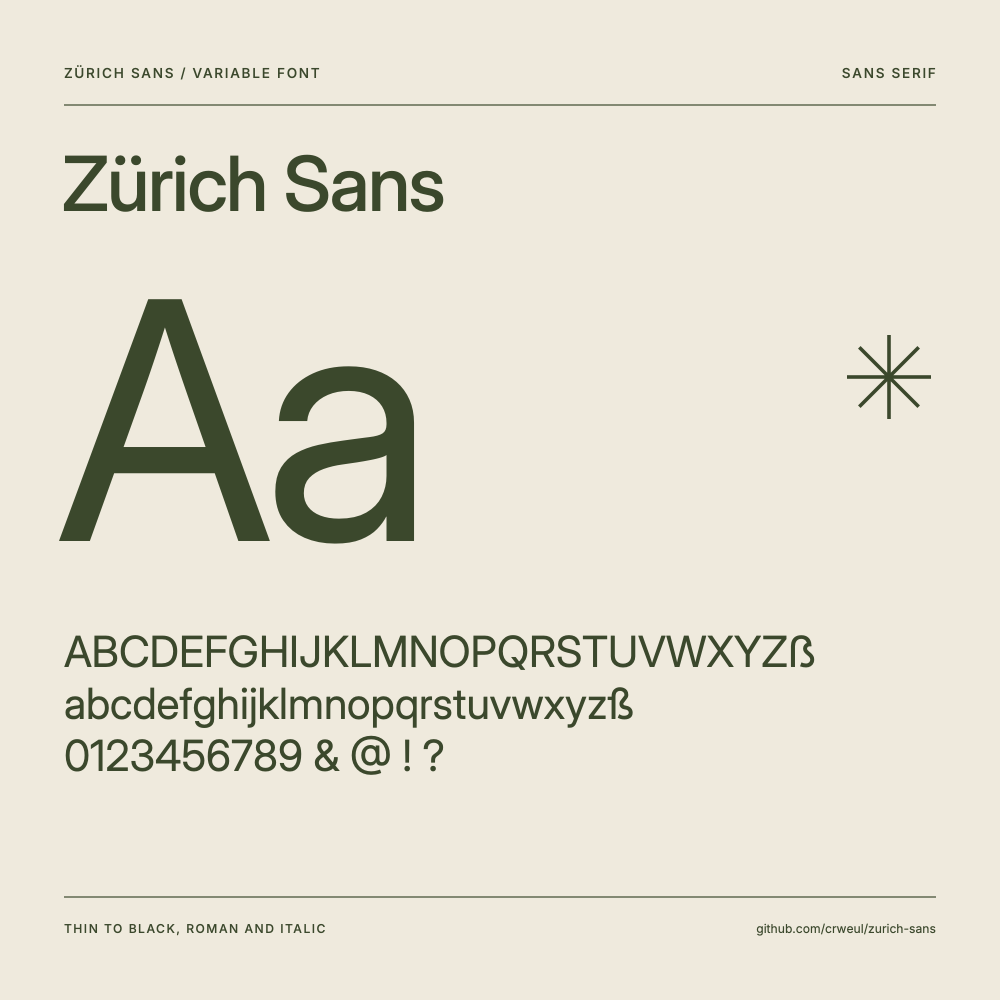

# Zürich Sans

A sans serif forked from **Inter 4.1** by Rasmus Andersson, set up to stand in for Apple's system font: Inter's
drawings at the system font's size, line height and line length, with:

- a redesigned **ß** and **ẞ**: an arch from the stem that goes over into an s, its stroke one even thickness
  from thin to black
- a long **ſ** with f's crossbar
- comma accents of one even length (Ș ț ķ ļ ņ ŗ ģ, ď ť ľ)

Every other glyph is Inter's. One variable font in roman and italic, weights
100 to 900 and optical sizes 14 to 32.

## Use

Fonts are in [`fonts/variable`](fonts/variable) (TrueType) and [`fonts/webfonts`](fonts/webfonts) (WOFF2).

```css
@font-face {
  font-family: "Zürich Sans";
  src: url("ZurichSans[opsz,wght].woff2") format("woff2");
  font-weight: 100 900;
  font-style: normal;
}
```

## License

[SIL Open Font License 1.1](LICENSE), with Reserved Font Name "Zürich Sans". The fonts are free to use, including
on websites and in apps. Modified versions must stay under the same license and may not use the name Zürich Sans.
